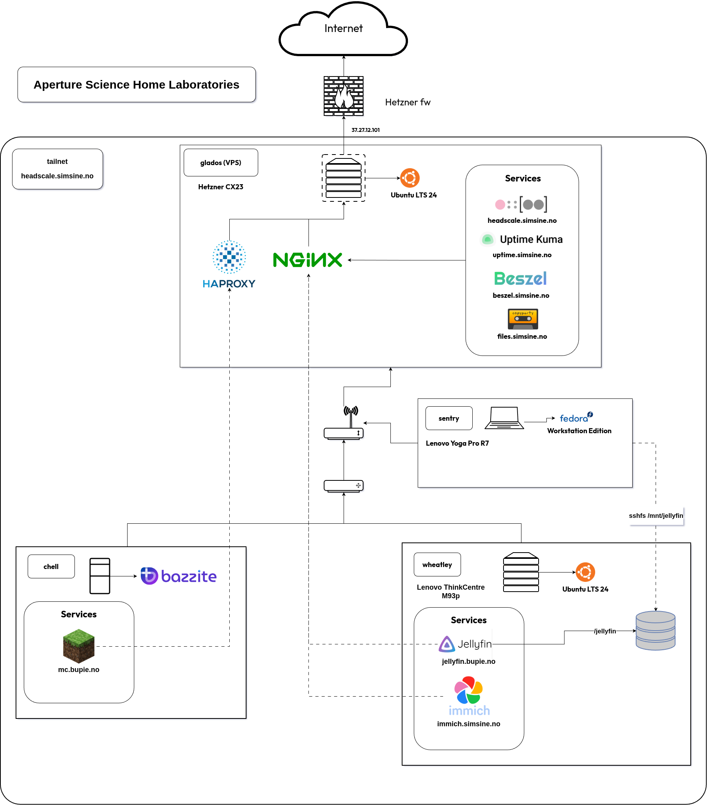

# Aperture Science Home Laboratories

## Hostnames

Hostnames are based on [characters from the Portal universe](https://web.archive.org/web/20250815063639/https://theportalwiki.com/wiki/Characters) by Valve

## Technical diagram

Can be edited with [drawio](https://app.diagrams.net/)



## Ansible

First create a sudo password file and vault key file

```bash
nano ./ansible/.ansible_sudo_password
```

```bash
nano ./ansible/.ansible_vault_key
```

To run ansible configurations

```bash
./run_config.sh
```

To run ansible host updates

```bash
./run_update.sh
```

## Headscale as exit node

If the headscale node has an id of 2 it can be allowed to be used as an exit node by entering the following

```bash
sudo headscale nodes approve-routes -i <NODE-ID> -r 0.0.0.0/0
```

```bash
sudo tailscale set --advertise-exit-node
```
